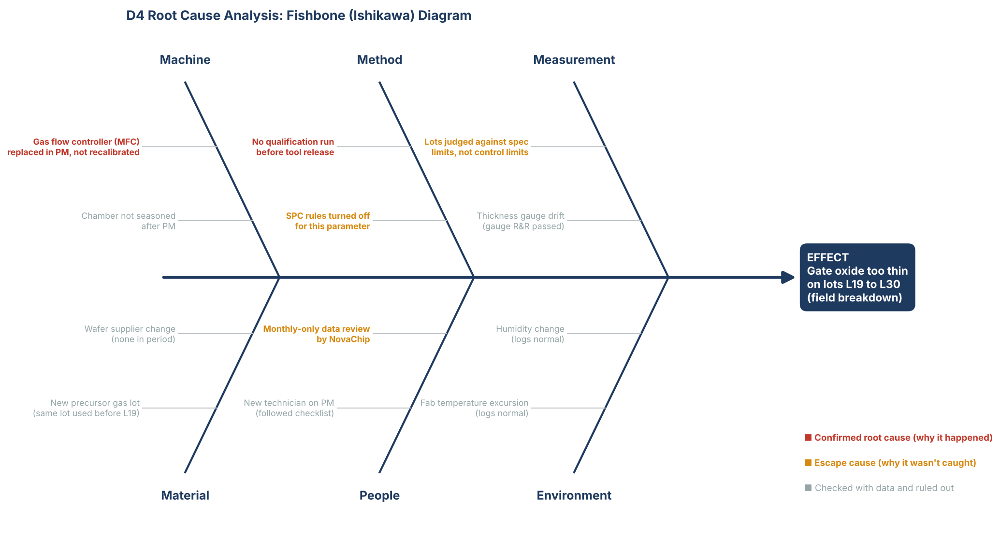
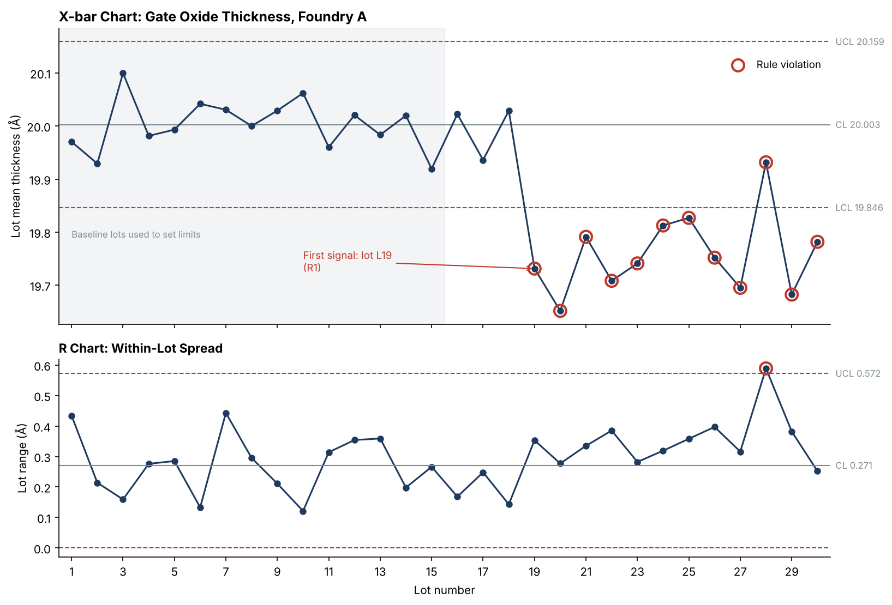
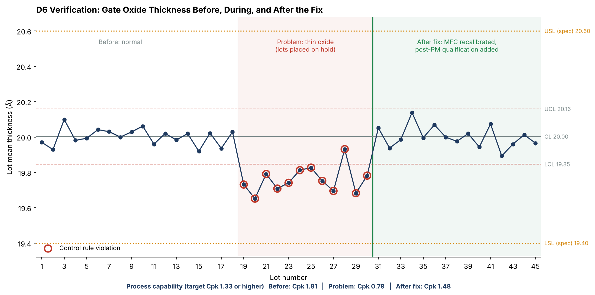

# 8D Report: Gate Oxide Breakdown, Foundry A Lots L19 to L30

> **Portfolio exercise.** NovaChip, Foundry A, the OSAT, the customer, and all data are fictional. The methods follow standard 8D and AIAG practice. Charts are generated by `quality_analysis.py` and `eight_d_figures.py` in this repo.

| Field | Value |
|---|---|
| 8D number | 8D-2026-014 |
| Product | NC-PM220 power management IC, automotive grade |
| Supplier | Foundry A (wafer fab), deposition tool DEP-04 |
| Customer | Tier 1 automotive module maker (fictional) |
| Opened | 2026-09-14 |
| Closed | 2026-10-30 |
| Author | Madison, Supplier Quality Engineer |
| Status | Closed, effectiveness verified |

---

## D0: Prepare and emergency response

On 2026-09-14 the customer reported a spike in NC-PM220 failures during their board-level burn-in test. Because the part goes into vehicles, the severity was treated as high and an 8D was opened the same day.

Emergency response within 24 hours:
- Customer told to quarantine all NC-PM220 stock on site
- Replacement parts shipped from inventory built before the suspect period
- Foundry A asked to stop shipping NC-PM220 wafers pending review

---

## D1: Form the team

| Role | Function | Responsibility |
|---|---|---|
| Team lead | NovaChip Supplier Quality | Owns the 8D, customer communication |
| Process engineer | Foundry A Thin Films | Deposition tool data and maintenance records |
| Failure analysis | NovaChip FA Lab | Physical analysis of returned units |
| Test engineer | NovaChip Test Engineering | Test data correlation, screening |
| Quality manager | Foundry A Quality | SPC system, foundry corrective actions |
| Champion | NovaChip Director of Quality | Removes roadblocks, approves closure |

---

## D2: Describe the problem

**Problem statement:** Customer burn-in testing found NC-PM220 units failing from gate oxide breakdown. Failure analysis confirmed thin gate oxide on wafers from Foundry A lots L19 to L30, all processed on tool DEP-04 after a maintenance event on 2026-08-10.

| 5W2H | Answer |
|---|---|
| What | Gate oxide breakdown under voltage stress |
| Where | Customer burn-in; traced to Foundry A tool DEP-04 |
| When | Lots processed 2026-08-11 to 2026-09-12 (L19 to L30) |
| Who found it | Customer burn-in test |
| Why it matters | Automotive part; breakdown means a dead module in a vehicle |
| How many | 48 failed units returned; 46 traced to L19 to L30 |
| How detected | Not detected by Foundry A or NovaChip before shipment |

### Is / Is Not analysis

This table narrows the search by comparing where the problem shows up to where it logically could but doesn't.

| | Is | Is Not | What it tells us |
|---|---|---|---|
| Lots | L19 to L30 | L01 to L18 | Something changed around L19 |
| Tool | DEP-04 | Other deposition tools | Tool-specific cause |
| Timing | After 2026-08-10 PM | Before the PM | Maintenance event is suspect |
| Defect | Oxide too thin (lot means 19.65 to 19.93 Å) | Oxide too thick | Deposition rate dropped |
| Spread | Within-lot spread mostly normal | Random scatter | Consistent offset, like a setting change |
| Spec | Every wafer inside spec (lowest 19.46 Å, LSL 19.4) | Out of spec | Why spec-based checks passed it |

Two of the 48 returns came from older lots. Their failure rate matches the normal background rate, so they were handled separately.

---

## D3: Containment actions

Goal: stop any more suspect parts from reaching the customer while the root cause is found.

| Action | Location | Quantity | Result | Date |
|---|---|---|---|---|
| Quarantine and replace | Customer site | 9,800 units | Replaced with pre-L19 stock | 2026-09-15 |
| Recall to hold | Distributor | 6,100 units | Returned to NovaChip | 2026-09-17 |
| Hold | NovaChip warehouse | 18,400 units | Held, screened (below) | 2026-09-15 |
| Hold WIP | Foundry A and OSAT | Lots L27 to L30 | Scrapped after review | 2026-09-15 |
| Take tool offline | DEP-04 | 1 tool | Production moved to DEP-02 | 2026-09-15 |
| 100% voltage stress screen | Held units | 18,400 units | 77 rejects (0.42%), rest released with customer approval | 2026-09-24 |

Traceability by lot number is what made this possible. Without lot tracking, every NC-PM220 in the field would have been suspect.

---

## D4: Root cause analysis

A good 8D finds **two** root causes: why the problem **happened** (occurrence) and why it **wasn't caught** (escape). Fixing only the first leaves the door open for the next problem to slip through the same way.

### Fishbone (Ishikawa) diagram

The team brainstormed every possible cause across six categories, then checked each one against data.

### SPC evidence

Foundry A's lot-level data, pulled by NovaChip during the investigation, shows the shift clearly. Lot L19, the first lot after the PM, fell below the lower control limit at 19.73 Å. Every lot through L30 triggered at least one Western Electric rule.

Lot L28 also showed one R-chart signal (range 0.589 Å vs UCL 0.572 Å). FA traced it to a single edge wafer and found no separate cause.

### 5-Why: occurrence (why it happened)

| Why? | Answer |
|---|---|
| 1. Why did units fail burn-in? | The gate oxide broke down under voltage stress. |
| 2. Why did the oxide break down? | It was about 0.24 Å thinner than target on lots L19 to L30. |
| 3. Why was it thinner? | DEP-04's deposition rate dropped after the 2026-08-10 PM. |
| 4. Why did the rate drop? | A gas flow controller (MFC) was replaced during the PM but not recalibrated, so it delivered slightly less precursor gas. |
| 5. Why wasn't it recalibrated? | **The PM procedure had no step requiring calibration and a thickness qualification run before releasing the tool to production.** |

### 5-Why: escape (why it wasn't caught)

| Why? | Answer |
|---|---|
| 1. Why did thin lots ship? | They passed Foundry A's inline thickness check. |
| 2. Why did they pass? | The check compared each wafer to the **spec limits** (19.4 to 20.6 Å). The lots were thin but still in spec. |
| 3. Why didn't SPC alarm? | Western Electric rule alarms were turned off for this parameter in Foundry A's SPC system. |
| 4. Why didn't NovaChip catch it? | NovaChip only received monthly summary reports, not lot-level data. |
| 5. Why only monthly summaries? | **The supplier quality agreement didn't require lot-level SPC data or rule-based alerts.** |

### Root cause verification

The team recreated the problem to prove the cause. With the uncalibrated MFC reinstalled on test wafers, DEP-04 produced oxide averaging 19.76 Å. After calibration, test wafers measured 20.01 Å. Turning the problem on and off like this is the strongest proof of root cause.

> **Key lesson: control limits are not spec limits.** Spec limits say what the customer will accept. Control limits say what the process normally does. A process can drift well outside its control limits and still be "in spec," and that drift is the warning sign. Here, thinner-but-in-spec oxide was enough to raise breakdown risk under automotive stress.

---

## D5: Choose permanent corrective actions

| Root cause | Corrective action | Owner |
|---|---|---|
| Occurrence: no post-PM qualification | Add MFC calibration and a 5-wafer thickness qualification run to the PM checklist. Tool can't be released unless the run lands within ±1 sigma of target. | Foundry A Thin Films |
| Occurrence: MFC out of calibration | Recalibrate DEP-04 MFC; verify with test wafers | Foundry A Thin Films |
| Escape: SPC alarms off | Turn on Western Electric rules 1 to 4 for gate oxide thickness on all deposition tools | Foundry A Quality |
| Escape: spec-only checks | Add automatic lot hold for any control limit violation, even if in spec | Foundry A Quality |
| Escape: no lot-level data | Revise supplier quality agreement: weekly lot-level SPC data to NovaChip, plus 24-hour notice of any rule violation on critical parameters | NovaChip Supplier Quality |

---

## D6: Implement and verify

All actions were in place by 2026-09-29. DEP-04 returned to production on 2026-09-30.

Verification used 15 production lots (L31 to L45) run after the fix:

| Period | Lots | Mean (Å) | Cpk | Rule violations |
|---|---|---|---|---|
| Before | L01 to L18 | 20.00 | 1.81 | 0 |
| Problem | L19 to L30 | 19.76 | 0.79 | 12 of 12 lots |
| After fix | L31 to L45 | 20.00 | 1.48 | 0 |

**Result:** The process is back on target, all 15 lots stayed inside the control limits, and Cpk recovered from 0.79 to 1.48, above the 1.33 automotive target. No customer failures have been traced to lots made after the fix.

**What Cpk means:** it measures how comfortably the process fits inside the spec. Above 1.33 means very few parts will ever land near the spec edge. At 0.79, the process was off center enough that some parts were close to failing.

---

## D7: Prevent recurrence

| Action | Scope | Status |
|---|---|---|
| Apply the new PM qualification step to all 6 deposition tools, not just DEP-04 | Foundry A | Done |
| Turn on SPC rule alarms for every critical parameter, not just oxide thickness | Foundry A | Done |
| Roll out the revised supplier quality agreement to NovaChip's other foundry and OSAT suppliers | All suppliers | In progress |
| Update the process FMEA with the revised ratings below | NovaChip | Done |
| Add this case to supplier quality training as a "control vs spec limits" example | NovaChip | Done |

Applying a fix to similar tools and processes beyond the one that failed is called **horizontal deployment**. Auditors and customers specifically look for it.

### FMEA update

| Failure mode | Before (S × O × D) | RPN | After (S × O × D) | RPN | Why it changed |
|---|---|---|---|---|---|
| Oxide too thin / pinholes | 9 × 4 × 5 | 180 | 9 × 2 × 3 | 54 | Post-PM qualification lowers occurrence; SPC alarms and lot holds improve detection |
| Oxide too thick | 8 × 5 × 4 | 160 | 8 × 2 × 3 | 48 | Same controls cover both directions |

Severity doesn't change. The effect on the customer is just as bad; it's now much less likely to happen and much more likely to be caught.

---

## D8: Close and recognize the team

The customer accepted the corrective actions and verification data on 2026-10-30, and the 8D was closed. The team was recognized at NovaChip's quarterly quality review, with credit to Foundry A's Thin Films group for recreating the failure within a week.

### Lessons learned

1. **Control limits catch problems that spec limits miss.** Every bad wafer here was in spec.
2. **Maintenance is a common trigger for process shifts.** Any tool coming out of PM needs to prove itself before running product.
3. **A fabless company is only as good as its visibility into suppliers.** Monthly summaries hid a shift that lot-level data showed on day one.
4. **Fix the escape, not just the cause.** The next problem won't be an MFC, but it will try to slip past the same detection gaps.
