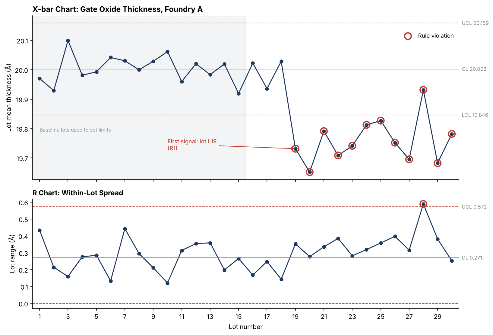

# Supplier Quality Monitoring: Fabless Semiconductor Case Study

A quality engineering project built in Python. It plays the role of a supplier quality engineer at a fabless chip company ("NovaChip") watching data from an outside foundry and assembly house, then running a full 8D investigation when a problem reaches the customer. All data is simulated.



**Start here:** [8D Report](8D_Report.md) walks through the whole investigation, from customer complaint to verified fix.

## What's in it

| File | Quality tool | What it shows |
|---|---|---|
| [`8D_Report.md`](8D_Report.md) | 8D problem solving | Full D0 to D8 investigation: Is/Is Not, containment, two-path 5-Why (occurrence and escape), corrective actions, verification, FMEA update. |
| `control_chart.png` | X-bar and R chart (SPC) | A deposition tool starts making thinner oxide at lot 19. Western Electric rules catch it on the first affected lot. |
| `pareto_chart.png` | Pareto analysis | 4 of 8 failure types drive 85% of customer returns. Gate oxide breakdown is #1. |
| `fishbone_diagram.png` | Ishikawa diagram | Suspected causes in 6 categories, marked as confirmed root cause, escape cause, or ruled out by data. |
| `verification_chart.png` | SPC + process capability | 15 lots after the fix stay in control. Cpk goes from 0.79 during the problem to 1.48 after. |
| `fmea_supplier_quality.xlsx` | Process FMEA | 8 failure modes across fab, assembly, test, and shipping. RPN and priority are live Excel formulas. |
| `lot_data.csv`, `lot_data_with_verification.csv` | Raw data | Wafer-level thickness readings with rule violations flagged. |

## How the pieces connect

1. **Pareto** says gate oxide breakdown is the biggest source of customer returns.
2. **Control chart** shows gate oxide getting thinner, starting at lot 19. Thin oxide is what breaks down under voltage stress.
3. **FMEA** had already ranked thin oxide as a top risk (RPN 180).
4. **8D** finds the root cause (a gas flow controller not recalibrated after maintenance) and the escape cause (the foundry checked against spec limits, not control limits, and NovaChip only saw monthly summaries).
5. **Verification chart** proves the fix worked, and the FMEA ratings are updated (RPN 180 to 54).

## Methods

- **Control limits** come from the first 15 lots (Phase I baseline), then later lots are judged against them (Phase II). Constants for subgroup size 5: A2 = 0.577, D3 = 0, D4 = 2.114.
- **Western Electric rules checked:** Rule 1 (point beyond 3 sigma), Rule 2 (2 of 3 beyond 2 sigma), Rule 4 (8 in a row on one side). Rule 3 is left as an exercise. Run rules restart after the confirmed fix.
- **Process capability:** sigma estimated as R-bar / d2 (d2 = 2.326). Cpk = distance from the mean to the nearest spec limit / 3 sigma. Spec is 20.0 ± 0.6 Å; target Cpk is 1.33 or higher.
- **FMEA scales** follow simplified AIAG conventions (1 to 10). Action threshold is RPN 100 or higher, or any Severity of 9 or higher. The 2019 AIAG-VDA handbook moved to Action Priority tables; RPN is used here because it's still common and easy to read.

## Run it

```bash
pip install -r requirements.txt
python quality_analysis.py    # control chart, Pareto, FMEA
python eight_d_figures.py     # fishbone, verification chart, Cpk
```

## Skills shown

Statistical process control, process capability (Cpk), 8D problem solving, root cause analysis (5-Why, fishbone, Is/Is Not), containment and traceability, FMEA, supplier quality management for a fabless model (foundry and OSAT), ISO 9001 / IATF 16949 style documentation, Python data analysis.
